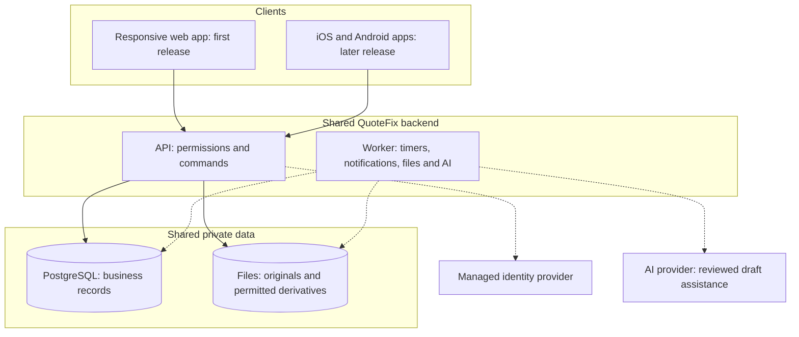

# QuoteFix web and mobile architecture

Draft 0.2 — 12 October 2026. **Design proposal, not implemented software or approved vendor procurement.** The owner has confirmed web first and eventual iOS/Android apps sharing the same operational data. Existing product decisions remain authoritative. See [implementation plan](../IMPLEMENTATION_PLAN.md).

## 1. The decision in plain language

Build the web app as the first client of QuoteFix's backend. A future mobile app will use that same backend, accounts, permissions, ticket IDs, files and history. There is no separate mobile business database to reconcile with a web business database.

The backend decides which action is valid now. Each device can keep a limited local copy for responsive screens and drafts. A phone's more recent timestamp does not give it authority to overwrite a newer approval, cancellation or payment record.

**Example:** MCST opens invoice version 4 on a phone. An authorised correction creates version 5 before MCST submits confirmation. The backend declines confirmation of the outdated version. The phone preserves any note, shows the permitted differences, and asks MCST to review version 5. It does not silently confirm the new amount.

## 2. Proposed structure

This is a proposed logical diagram, not a picture of deployed infrastructure. Solid lines show API control/persistence paths; dotted lines show background work or external integrations. Both clients use the same API. To keep the diagram readable, direct upload paths are described here: large file bytes travel from either client directly to private storage using narrowly authorised upload grants; the API still controls attachment and visibility.



### One backend, clear internal modules

Use a **modular monolith**: one backend codebase and database, with a separately running worker using the same domain modules. Modules do not call each other's database tables arbitrarily. A command handler coordinates the transaction when a business outcome crosses modules.

| Module | Owns | Important boundary |
| --- | --- | --- |
| Identity and access | Users, organisations, estate memberships, capabilities, access changes | All four roles use the same permission service; confidential-subject exclusions override broad role access |
| Contractor eligibility | Verification decisions, credentials, category prerequisites, restrictions | Optional badge expiry differs from required eligibility; current authorised work is treated separately from new quoting |
| Sourcing | Drafts, RFQ revisions/rounds, Q&A, visits, quote versions | Contractor can never read rival quotes; material changes require reconfirmation |
| Authorisation and delivery | Selection, approvals, authorised terms, Start, schedule versions, variations, inspection rounds | Every approval names the precise terms and version reviewed |
| Settlement | Invoice versions, confirmation, transfers, receipt facts, balance | Proof and reporting are not bank settlement; actual and assumed receipt remain distinguishable |
| QuoteFix billing | Two 4% components, adjustments, allocations, restrictions | Contractor account area and Admin collection views; never the CM/MCST ticket payload |
| Support and aftercare | Cases, evidence requests, Admin resolution, obligations, acknowledgments | Evidence submission cannot issue a resolution; acknowledgment cannot complete a repair |
| Feedback and intelligence | Observation tasks, moderated feedback, scoring/comparison inputs, integrity settings | Formula/default choices stay gated by the specialist plans; no synthetic live history |
| Shared infrastructure | Files, audit, task scheduling, notifications, exports, sync | Reusable mechanics; each module still owns its business rules |

The 83 lifecycle review nodes are explanatory anchors. They are not 83 database statuses or 83 independent services.

## 3. Recommended stack and what remains to choose

The following is an engineering recommendation. It is intentionally specific enough to estimate and prototype, while distinguishing framework choice from paid hosting/account commitments.

| Layer | Recommended starting point | Why / verification gate |
| --- | --- | --- |
| Web | React + TypeScript with Vite, responsive layouts | An authenticated application can use a straightforward client app. Public marketing/SEO is a separate concern; do not require server-rendered business logic to serve mobile |
| API | TypeScript on a supported Node.js LTS, Fastify, explicit domain services | Schema validation and ordinary HTTP endpoints; portable across web/native. Pin supported versions after the contract/tooling spike |
| Database | Managed PostgreSQL, SQL migrations and a typed query layer | Transactions, constraints and row locks for approval/payment races. SQL and migrations remain inspectable; no client writes directly to business tables |
| Jobs | Database-backed durable jobs/outbox, dedicated worker process | Reuse PostgreSQL initially; no extra broker is required merely for expected early traffic. Select a maintained job library after restart/lease/retry tests |
| Files | Private object storage supporting checksums, multipart uploads and immutable/version-specific objects | Keep large media outside relational rows. AWS S3 is a reference implementation, not a signed hosting decision |
| Authentication | Managed identity supporting browser sessions and native OAuth authorization code + PKCE | Provider handles credentials; QuoteFix owns membership, estate access and business authorization |
| Contracts | Versioned HTTP API, OpenAPI document, generated typed client, runtime schemas | Both clients consume the same contract. Pin a specification version supported by the selected generator; do not automatically use a moving `latest` schema |
| Later mobile | React Native with Expo as the first candidate | Potential reuse of TypeScript contracts/validation/client logic. Native screens, storage, camera, secure credentials and transfer adapters still need separate work |
| Operations | Managed hosting in a selected Singapore-region deployment where available; structured logs, error reporting, backups | Confirm all vendors' regional coverage, recovery, budget and ownership before provisioning; region preference alone is not a data-residency guarantee |

Vite supports a React/TypeScript starting template; Fastify documents schema-based validation; Expo targets Android/iOS and web. These capabilities support the candidate stack, but do not prove that every chosen camera/upload library works in the background. See [Vite](https://vite.dev/guide/), [Fastify](https://fastify.dev/docs/latest/) and [Expo](https://docs.expo.dev/).

Prefer a responsive web release over a wrapper submitted to app stores. Keep the native client separate until camera, offline storage and background transfers justify its implementation. Shared contracts and domain semantics are the main reuse; do not force every web component into a native component library.

### Proposed repository layout

```text
apps/web/                responsive web client
apps/api/                HTTP/authentication adapters
apps/worker/             durable jobs, file processing, AI requests
apps/mobile/             reserved for later; no empty application needed now
packages/domain/         server-side rules and command handlers
packages/contracts/      request/response schemas and API specification
packages/api-client/     generated client plus transport adapters
packages/presentation/   shared labels/formatters without permission authority
packages/test-fixtures/  fictional scenarios; never production seed data
database/migrations/     reviewed schema changes
```

Only safe presentation/schema code ships to devices. Database credentials, privileged policy logic, AI keys and storage signing stay server-side. A shared TypeScript type is not runtime validation or an access check.

## 4. Current state, versions and concurrent decisions

Three different notions of “latest” must not be collapsed:

1. **Current business state:** the latest committed state accepted by the server's rules.
2. **Document version:** the immutable quote, RFQ, invoice or variation the person reviewed.
3. **Device freshness:** when this particular screen last successfully refreshed.

Each decision carries the document IDs and an expected resource version. Conditional writes prevent lost updates; a transaction rechecks all relevant business facts. Client clock time and last-write-wins do not choose between competing financial or approval actions. HTTP `If-Match` is designed for conditional changes; PostgreSQL provides the transaction/locking mechanisms. See [HTTP semantics](https://www.rfc-editor.org/rfc/rfc9110.html#name-if-match) and [PostgreSQL locking](https://www.postgresql.org/docs/current/explicit-locking.html).

Use separate versions for independently edited resources. A new optional progress photo should not invalidate an otherwise unchanged invoice review. A material RFQ revision, authorised-total change, inspection resubmission or restriction change must invalidate the affected decision context. The backend checks those dependencies even if a client's main resource version still matches.

See [API/data/sync contract](API_DATA_SYNC_CONTRACT.md) for concrete commands, race outcomes and recovery.

## 5. Offline behavior and honest UX

**O37-A confirmed by the owner's explicit answer on 12 October:** drafts and media may be saved/queued locally; publishing, quoting, selection, approvals, Start, completion declaration, cancellation, payment/receipt, inspection results and Admin verdicts require an online server-validated submission. Do not queue these silently for later execution. The table below proposes copy/presentation for that approved boundary.

| Situation | Proposed experience |
| --- | --- |
| CM photographs a fault with no connection | Save a local draft and upload queue. Show “Saved on this device · not submitted” |
| Contractor writes a quote offline | Preserve the draft; reconnect, fetch current RFQ, review changes, then explicitly submit |
| Invoice upload loses connection | Retain upload state; resume eligible parts. “Uploading” never becomes “Work complete” |
| User presses an action but the response is lost | Show “Checking submission”; look up/retry the same command ID. Do not invite a fresh payment record while outcome is unknown |
| Two devices edit the same draft | Preserve both text versions; show a focused difference for the overlapping field. Never silently overwrite one |
| Cached ticket opened offline | Show last-refreshed time and unavailable actions. Countdown expiry on a device cannot perform a server transition |
| Connection returns | Refresh access and relevant records before final actions; keep local drafts separate from server-approved facts |

Native UI can read from a local database populated by network synchronization. The backend remains authoritative for QuoteFix decisions. Android's guidance supports a local data layer and explicit reconciliation; QuoteFix's financial workflow requires stricter conflict handling than generic last-write-wins. [Android offline architecture](https://developer.android.com/topic/architecture/data-layer/offline-first).

Web local storage is best-effort: browsers can evict it, private sessions can discard it, and a closed tab cannot promise continued upload. Tell the user when a file remains only on the device. Do not label a local draft “backed up” until the server has stored it.

## 6. Media and documents

Use a shared upload protocol for the web and future native app:

1. Authenticate and request an upload intent for a specific draft/resource and media purpose.
2. Server assigns a private staging key, expected size/type/checksum and short-lived upload grant. Client cannot choose another estate's destination.
3. Transfer directly to storage. Use resumable multipart uploads for larger assets and retry only failed parts. Renew grants only after fresh access checks.
4. Server finalizes the precise object version, verifies size/checksum/type, scans and generates safe previews/derivatives. Failed or pending files cannot be used as required submission evidence.
5. Mark the media ready and attach it through an authorised version-checked command. Upload completion alone cannot publish an RFQ, declare work complete, record Payment Sent or reveal an address.

Keep restricted originals separate from contractor-visible sanitized copies. Remove metadata from derivatives and require the established CM preview for visible identifiers; automated stripping cannot remove a condo name photographed on a wall. A file's allowed audience follows its purpose and parent record, not a user-supplied “public” flag.

Presigned URLs can be reused until expiry and may overwrite the same object key. Therefore grants target staging objects only; finalization pins a verified object version or promotes a verified copy to a server-only immutable key. Approved invoice/proof content cannot change behind the same attachment ID. Multipart and signed URLs are storage capabilities, not an entire synchronization solution. [S3 multipart](https://docs.aws.amazon.com/AmazonS3/latest/userguide/mpuoverview.html), [S3 signed URLs](https://docs.aws.amazon.com/AmazonS3/latest/userguide/using-presigned-url.html).

For native iOS, background file uploads require file-backed transfer handling and can be scheduled/delayed by the OS. Verify Android persistent work and the chosen native transfer adapter on real devices. An Expo choice does not by itself guarantee killed-app recovery. This is an explicit technical spike before promising background uploads. [Apple background transfers](https://developer.apple.com/documentation/foundation/downloading-files-in-the-background).

Configure accepted formats, per-file/total limits, compression quality and orphan-cleanup windows during the upload spike. Preserve evidence originals; never replace proof with a lossy thumbnail. Add camera capture, document picker, orientation handling, thumbnail generation and HEIC/PDF preview cases to acceptance tests.

## 7. Authentication, permissions and confidentiality

- Web: same-origin API with secure HttpOnly session cookies, CSRF protection and Origin checks for mutations; no long-lived credentials in browser localStorage.
- Native: external-browser authorization code flow with PKCE, system-protected credential storage and revocable sessions. No embedded client secret or password collection in an arbitrary WebView. [RFC 8252](https://www.rfc-editor.org/rfc/rfc8252.html), [OAuth security BCP](https://www.rfc-editor.org/rfc/rfc9700.html).
- Both: identify the account, then authorize against current QuoteFix memberships, restrictions and resource access. A client-selected role/estate or an old token claim cannot grant authority.
- Every file download, audit entry, export, sync page and notification uses the same audience policy. Ordinary MCST access does not override confidential-subject exclusion. Mask before sending data; CSS hiding is not protection.
- Namespace caches by account, estate and access context. Clear on logout/context change; invalidate on revocation. An offline device cannot be remotely guaranteed to erase already downloaded information, so confidential conduct files and highly sensitive views should remain online-only in the initial cache policy proposal.
- Log named human decisions even if permissions are equal within a role. Admin powers use explicit command types, reasons and before/after records; they are not an unrestricted status-edit endpoint.

## 8. Bells, real-time updates and future push

The app's durable bell/task records are the source of notification truth. Web polling or a later real-time stream tells a client to refresh. Later APNs/FCM push is an optional delivery adapter, subject to a separate channel decision; the current in-app-only launch rule stands.

The seven-day payment/cancellation clocks use the first durable in-app notice issuance, not when a phone receives push, reads the bell or reconnects. Delayed push cannot postpone or restart a clock. Opening a notification deep link performs fresh login/access checks and loads current state; sensitive details should not appear on lock-screen payloads.

Countdowns come from server `dueAt`, `serverNow` and the approved calendar. They count down toward the named action (for example, Admin payment follow-up), not an invented MCST payment deadline.

## 9. Delivery order and store readiness

**Build with web:** public API boundary, versioned contracts, permissions, idempotency, immutable decisions, private uploads, server timers, mobile-sized web forms, reconnect/error recovery and API compatibility tests.

**Prepare but defer native implementation:** local database adapter, camera/doc picker integration, background-transfer bridge, universal/app links, device registration, native credential storage and store release tooling. Full incremental offline sync can be deferred; conditional reads plus refresh-on-focus are adequate for the initial connected web app if they preserve the contract below.

**Before mobile release:** test interruptions on real iOS/Android devices, support an older installed app against a newer backend, review privacy disclosures/permissions and define account deletion versus retained audit/financial records. Account removal must not mean deleting the estate's history. Apple and Google publish account-deletion/review requirements; re-check them at native release and approve the retention policy separately. Do not assume the Contractor-to-QuoteFix fee purchase flow automatically fits every store rule. [Apple review guidelines](https://developer.apple.com/app-store/review/guidelines/), [Google account deletion](https://support.google.com/googleplay/android-developer/answer/13327111).

## 10. Simplicity constraints

- No separate web/mobile rule engines, databases or approval routes.
- No microservices, Kafka, graph database, general event-sourcing framework or collaborative-text CRDT merely to support mobile. Transactional records plus immutable business history and an outbox are sufficient for this proposed first architecture.
- No automatic merge of money, authority, inspection outcomes or published scope.
- No direct unrestricted database subscriptions exposed to clients. Sync is a permission-filtered API projection.
- No background device scheduler deciding legal/business outcomes; server workers apply the same rules as online commands.
- Avoid abstract frameworks for hypothetical scale. Keep a clear seam where a proven capacity or native requirement later needs a different adapter.

## 11. Planning gates

O37-A offline submission behavior is approved; future push, persistent cache scope/retention, native role rollout, account deletion/retention, fee rounding and final paid vendors are not approved by this document. Existing O30 timing, O29 archive and specialist reputation/integrity gates remain. Ordinary implementation details are engineering proposals ready for validation, not additional business decisions hidden in defaults.
